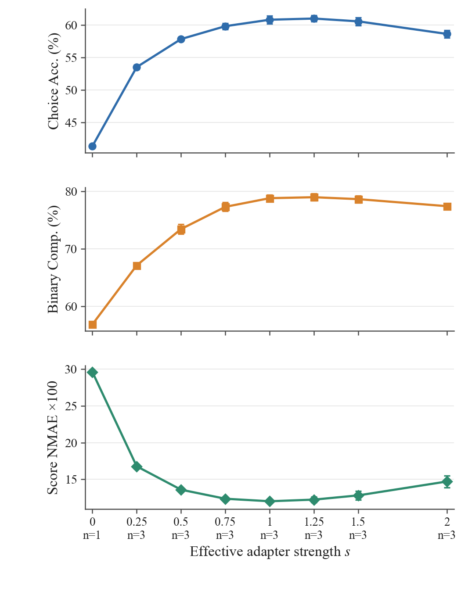
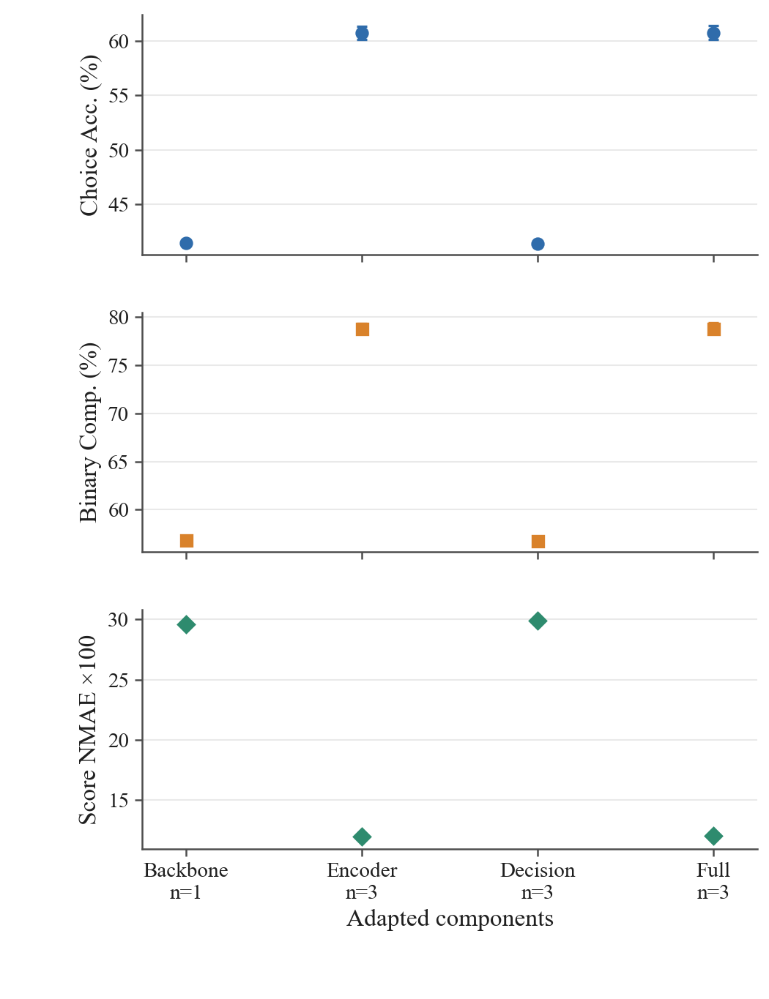
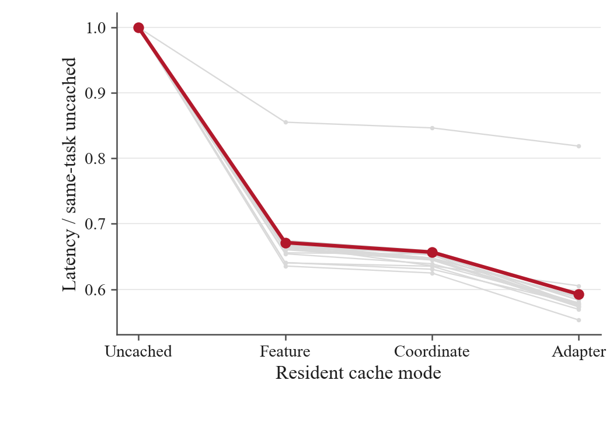

# Fixed-checkpoint mechanism experiments

This directory contains the three additional experiments for the final evaluation descriptions in [`data/eval_views.json`](../../data/eval_views.json). All use the fixed released-backbone PCA-T2L student: 60 teachers, K=60, native rank 64, 929,984 trainable generator parameters, R1000+CE200, balance lambda=0, and KD=0. No model is retrained for these interventions.

## Rebuild and verify

From the repository root, with the root requirements installed:

```sh
python figures/new_experiments/validate_results.py
python figures/new_experiments/plot_new_mechanisms.py
```

PDF and 300-dpi PNG figures are written to `figures/new_experiments/figures/`. The scripts read only committed CSV scalars and require no GPU, model weights, dataset records, or server connection. The raw per-seed primary/NLL values, dataset-equal summaries, timing distributions, memory statistics, and storage counts are under `data/`. `configuration.json` records the exact protocol. Choice is accuracy, Binary is `(Acc+Yes-F1+BAcc)/3`, and Score is range-normalized MAE. Figures multiply all three primary fractions by 100; native NLL is unscaled. Standard deviations are sample SD over actual model seeds.

## 1. Effective-adapter strength

The fixed grid is `s = 0, .25, .5, .75, 1, 1.25, 1.5, 2`. Apply `B -> s*B` at all 96 native sites while retaining A and the original unit-scale adapter convention. This is an inference-time multiplier of the effective update, not the training balance coefficient or KD mixing ratio. Nonzero points use seeds 42, 43, and 44; s=1 reuses the same original full-model results. The new zero-B measurement has n=1 and is not an untrained RAW0 student.

## 2. Encoder/decision-layer injection sites

Keep all 96 dictionary keys and all A tensors; zero B only at disabled sites. `encoder_only` retains 88 sites in the 22-layer decision-model encoder; `head_only` retains eight sites in its two Transformer decision layers; `full` retains all sites. The final scalar scorer has no LoRA. The separate description encoder remains frozen and bare. Trained checkpoint interventions use the same seeds 42–44, masks, native query, options, and targets; the deterministic no-adapter backbone control has n=1.

The reusable scientific operators are in [`schemajev/mechanisms.py`](../../schemajev/mechanisms.py):

```python
from schemajev.mechanisms import transform_adapters

adapters = model.hypernet.adapter_for_document(decoded_factors, 0)
scaled = transform_adapters(torch, adapters, strength=0.5)
encoder_only = transform_adapters(torch, adapters, components="encoder_only")
```

Pass the returned dictionary to the original native query adapter controller. Apply it after extracting one document's unbatched A/B factors, including the frozen decoder prior; modifying coordinates alone would not suppress the prior. The API does not mutate checkpoint parameters or change the native query/scorer. It is an integration module for the native LAYA runtime, not a standalone evaluator. CPU-only synthetic checks are available with PyTorch installed:

```sh
python figures/new_experiments/checks.py
```

## 3. Runtime, memory, and storage

The measured checkpoint is seed 43 on one NVIDIA A800-SXM4-80GB. Three independent process starts measure the complete validated cold response, including source binding, whole-checkpoint SHA/I/O, restore, and the explicit original TRAIN numerical validation. OS page cache was not forced cold. Adapter-generation latency is a separate field; the complete validated response is not generator-only latency.

Resident measurements use each of the 18 task descriptions, ten warmups, and 50 repeats per stage/cache mode, on the same first native microbatch of up to four records under the nominal 4,096-token budget. The native oversized-singleton rule retains one SCOTUS record with 6,105 padded tokens; the other 17 task microbatches contain four records and at most 1,800 padded tokens. Cache modes are uncached, cached feature, cached coordinates, and materialized adapter. Distinct stage measurements are standalone and must not be summed. The 50 timing repeats are not 50 model seeds. Peak allocated and reserved CUDA memory, per-task logical/unique tensor storage, and existing shared files are recorded separately. Teacher training time is unavailable in this benchmark and remains null rather than zero. The measurements do not establish latency superiority over other methods.

[`schemajev/runtime_benchmark.py`](../../schemajev/runtime_benchmark.py) exports synchronized CUDA `measure`, the four-mode `profile_services`, and logical/unique `tensor_storage` helpers. An integration caller supplies an already-restored evaluation model, the fixed native microbatch, the four service callbacks, and a device/process-isolation check that raises if a co-tenant appears. CUDA-event and synchronized wall times are reported separately, with median, p90, mean, sample SD, and peak-memory statistics. There is no model loading, remote scheduling, authentication, or GPU allocation at module import.

## Figure previews







The resident timer is reusable instrumentation, not the native cold-loader driver. Reproducing the cold table additionally requires the original model restore, checkpoint SHA/I/O, and TRAIN numerical validation in fresh processes. The native loader, weight files, and canonical record bodies are not redistributed here. CUDA callbacks must use the current stream or join any auxiliary work before returning.
